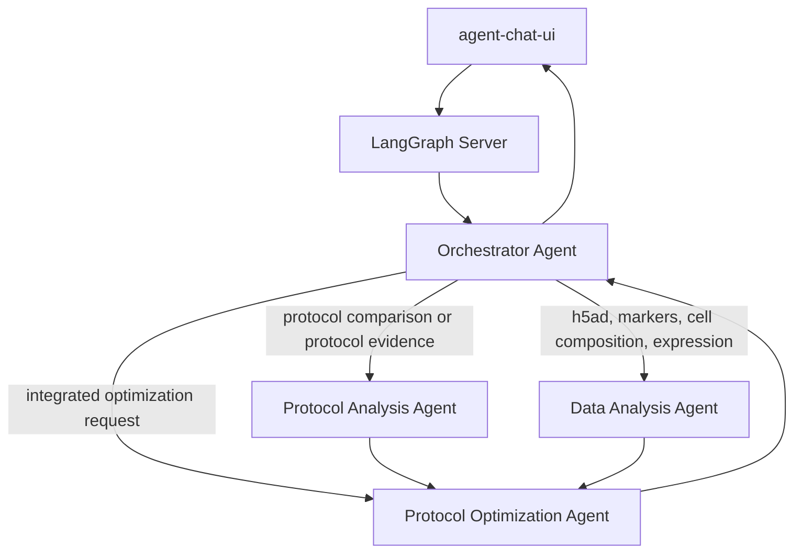
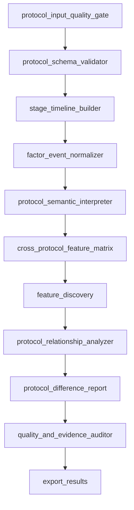
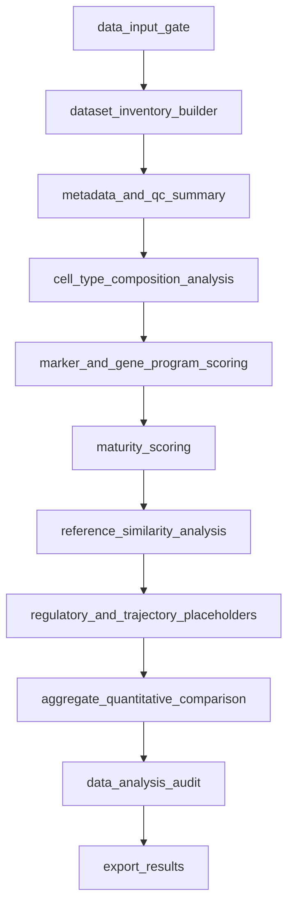

# ProtocolOptimizationAgent Current Architecture

This document records the current project architecture, implemented technical details, completed work, and near-term design direction.

## Goal

ProtocolOptimizationAgent is a downstream analysis system for pancreatic / islet organoid differentiation protocol optimization.

The upstream Agent1 project extracts evidence-grounded structured protocol artifacts from papers and files. This project consumes those artifacts, converts protocols into computable representations, and prepares them for comparison, visualization, h5ad integration, and protocol optimization.

The intended end-to-end flow is:

```text
Scientific literature and protocol files
  ↓
Agent1 protocol extraction
  ↓
ProtocolOptimizationAgent
  ├─ Protocol Analysis Agent
  ├─ Data Analysis Agent
  └─ Protocol Optimization Agent
  ↓
Evidence-supported improved protocol proposal
```

## Repository Layout

```text
backend/
  protocol_optimization_agent/
    agents/
      protocol_analysis.py        # Implemented Protocol Analysis Agent
      data_analysis.py            # Data Analysis Agent framework and h5ad-compatible output contracts
    orchestrator_agent.py         # External Orchestrator Agent graph and SubAgent routing tools
    api.py                        # FastAPI backend API boundary
    langgraph_server.py           # LangGraph server chat graph for agent-chat-ui
    query_engine.py               # Deterministic protocol query and visualization tools
    input_loader.py               # Agent1 artifact loader
    feature_discovery.py          # FeatureSpec discovery/audit/compiler
    schemas.py                    # Pydantic schemas
    normalization.py              # Factor/event normalization
    semantic_annotation.py        # Stage strategy annotation
    audit.py                      # Evidence and consistency audit
    subgraphs.py                  # Agent subgraph metadata and Mermaid rendering
  tests/

frontend/
  src/                            # agent-chat-ui based Next.js frontend
  next.config.mjs                 # Next dev/LAN config

configs/
  base_feature_registry.json
  approved_feature_registry.json
  default_config.json

inputs/
  Protocols inputs/               # Local Agent1 outputs

runs/
  protocol_analysis_agent_simplified_autofeatures/

docs/
```

## Runtime Boundary

The architecture separates UI, API, and agent execution:

```text
agent-chat-ui frontend
  ↓
LangGraph Server
  ↓
Chat / Orchestrator graph
  ↓
Agent tools and deterministic local query tools
```

Current frontend:

- Based on `agent-chat-ui`.
- Responsible only for chat UI, streaming display, and tool-call visualization.
- Connects to LangGraph Server through `NEXT_PUBLIC_API_URL`.

Current backend:

- Provides local FastAPI endpoints for direct API operations.
- Provides LangGraph Server graph `protocol_chat`.
- Uses deterministic tools for protocol retrieval, comparison, matrix querying, provenance lookup, and heatmap generation.

Current LangGraph graphs:

- `protocol_chat` is exposed in `langgraph.json`.
- It streams LLM responses and visible tool calls.
- It currently routes to Protocol Analysis query tools.
- `orchestrator` is exposed in `langgraph.json`.
- It routes user questions to callable SubAgent tools for Protocol Analysis, Data Analysis, and Protocol Optimizing workflows.

## Recommended Orchestrator Design

The long-term chat entrypoint should be an external Orchestrator Agent rather than a single domain agent.



Routing examples:

- "What are the protocol differences between paper A and paper B?" -> Protocol Analysis Agent.
- "What is beta cell marker expression in this dataset?" -> Data Analysis Agent.
- "Use all protocols and h5ad data to propose a better protocol." -> Protocol Analysis Agent + Data Analysis Agent + Protocol Optimization Agent.

Current implementation status:

- Protocol Analysis Agent: implemented.
- Data Analysis Agent: framework implemented with deterministic placeholder tool contracts.
- Protocol Optimization Agent: scaffolded through IntegrationOptimizationAgent outputs and Orchestrator tool boundary.
- External Orchestrator Agent: framework implemented as a LangGraph entrypoint.

## Protocol Analysis Agent

The Protocol Analysis Agent is the first implemented domain agent. It consumes Agent1 structured outputs and builds a Protocol Intelligence Layer.

### Inputs

Minimum intended inputs:

```text
inputs/Protocols inputs/
  protocol_factor_events.csv
  protocol_database.sqlite
  source_identity_inventory.csv
  protocol_artifacts.jsonl        # Optional when SQLite is available
```

Current loader behavior:

- Uses `protocol_artifacts.jsonl` when available.
- Reconstructs protocol records from `protocol_database.sqlite` when JSONL artifacts are absent.
- Uses `protocol_factor_events.csv` as event-level structured input.
- Uses source identity inventory data when available to validate source/paper mapping.

Quality gates:

- Prefer `comparison_ready=true`.
- Require minimum protocol confidence by default.
- Keep only accepted validation statuses by default.
- Reject unparsed numeric fields where configured.
- Require evidence quotes for key factor/event types.

### LangGraph Subgraph

`ProtocolAnalysisAgent.run()` executes an internal LangGraph `StateGraph`:



### Hybrid Rule + LLM Design

LLM usage is deliberately constrained:

- LLM may normalize ambiguous factor/event names.
- LLM may annotate biological stage strategy.
- LLM may propose candidate FeatureSpec columns.
- LLM may support audit explanations.
- LLM must not write final matrix values.

Deterministic code remains responsible for:

- Input filtering.
- Schema validation.
- Graph construction.
- Matrix value computation.
- Similarity calculation.
- Embedding and clustering.
- Heatmap generation.
- Provenance export.

Every final matrix value must be computable from accepted structured events, protocol/stage fields, graph structure, and evidence provenance.

## Organoid-UWL-Inspired Representation

The project borrows the useful idea from UWL-style protocol representation: the graph is the low-loss representation, and the matrix is a projection compiled from the graph.

Current per-protocol workflow graph:

```text
Protocol
  ├─ Stage nodes
  ├─ Action nodes
  ├─ Reagent / factor item nodes
  ├─ next_stage edges
  ├─ next_action edges
  └─ action -> item edges with item_role
```

Current action nodes include:

- `action_class`: `add`, `remove`, or `modify`
- `operation`
- `factor_type`
- `timing`
- `day_start`
- `day_end`
- `evidence_quote`

Current item-role edge examples:

- `mobile_item_added_or_applied`
- `environment_or_stationary_context`
- `measurement_target_or_readout`
- `associated_item_or_parameter`

The graph is saved in:

```text
runs/protocol_analysis_agent_simplified_autofeatures/protocol_workflow_graphs.json
```

## Feature Matrix Design

The final matrix is:

```text
Protocol x Feature
```

Current generated matrix:

```text
runs/protocol_analysis_agent_simplified_autofeatures/protocol_feature_matrix.csv
```

Current default run statistics:

```text
protocols: 102
features: 2369
coverage: pass
```

Main feature families:

- Metadata features.
- Temporal features.
- Core reagent family features.
- All accepted reagent identity features.
- Structured factor type features.
- Standardized action category features.
- Normalized factor family features.
- Semantic strategy module features.
- Reagent order features.
- Graph topology features.
- Action sequence bigrams.
- Factor type sequence bigrams.
- All-reagent transition features.
- Action-item motif features.
- Dependency features.
- Approved registry FeatureSpec features.

### Predefined Feature Registry

The project now treats full reagent/action/factor coverage as predefined quantitative features.

Registry output:

```text
runs/protocol_analysis_agent_simplified_autofeatures/predefined_feature_registry.json
```

Current predefined feature count:

```text
all_reagent:      139 entities x 6 features = 834
factor_type:       13 entities x 4 features = 52
action_category:   18 entities x 3 features = 54
total predefined features: 940
```

Each predefined feature includes:

- `feature_name`
- `feature_type`
- `level`
- `biological_category`
- `definition`
- `value_rule`
- `source_fields`
- `required_evidence`
- `computed_by`
- `approved_status`

### Graph-Derived Features

Current graph-derived sequence/topology features include:

```text
graph_*                       # topology statistics
action_bigram_*               # action order
factor_type_bigram_*          # factor type order
all_reagent_transition_*      # all reagent order transitions
motif_action_*_uses_reagent_* # action-item motifs
```

Current default run counts:

```text
graph_: 8
action_bigram_: 119
factor_type_bigram_: 122
all_reagent_transition_: 578
motif_action_: 139
```

Important implementation detail:

- Event ordering is deterministic.
- `day_start=0` is correctly preserved as a real day, not treated as missing.
- Sorting falls back to `stage_index`, `stage_id`, `event_id`, and factor name only when needed.

### Coverage Audit

Coverage report:

```text
runs/protocol_analysis_agent_simplified_autofeatures/quantification_coverage_report.json
```

Current status:

```text
status: pass
missing_reagents: []
missing_factor_types: []
missing_action_categories: []
n_uncategorized_action_events: 0
missing_provenance_columns: []
```

The coverage scope is `accepted_filtered_analysis_events_only`. Excluded protocols/events remain in quality reports and filtered event reports, but they do not enter the final matrix.

## Query And Visualization Tools

The LangGraph chat agent currently exposes these tools:

```text
find_protocols
compare_protocols
get_protocol_events
get_feature_evidence
query_matrix
explain_cell
plot_protocol_feature_heatmap
plot_layered_protocol_feature_heatmaps
propose_feature_specs_context
```

Visualization capabilities:

- Single clustered feature heatmap.
- Layered clustered heatmaps.
- HTML index page for layered heatmaps.

Layered heatmap families:

- semantic
- workflow
- action_category
- factor_type
- reagent
- normalized_family
- temporal_exposure
- graph_topology
- motif
- sequence, optional because it is sparse and high-dimensional

Example output:

```text
runs/protocol_analysis_agent_simplified_autofeatures/visualizations/layered_protocol_feature_heatmap_index.html
```

## Data Analysis Agent

The Data Analysis Agent quantifies organoid h5ad datasets against in vivo reference atlases. The current implementation is an executable framework with deterministic placeholder tool contracts, so downstream integration can depend on stable output files before scanpy/anndata-backed numeric methods are connected.

Implementation:

```text
backend/protocol_optimization_agent/agents/data_analysis.py
backend/protocol_optimization_agent/tools/h5ad_tools.py
docs/data_analysis_agent_tools.md
```

Minimum intended inputs:

```text
reference_atlas_h5ad                  # in vivo reference atlas
organoid_h5ad_manifest                # protocol/dataset/sample/condition-linked h5ad rows
gene_programs                         # lineage -> program -> genes
metadata_config                       # obs column names and matching keys
```

`DataAnalysisAgent.run()` executes an internal LangGraph `StateGraph`:



Current outputs:

```text
h5ad_summary_by_protocol.jsonl
h5ad_qc_report.json
cell_type_composition.csv
marker_scores.csv
gene_program_scores.csv
maturity_scores.csv
similarity_scores.csv
regulatory_program_scores.csv
trajectory_scores.csv
data_analysis_protocol_summary.csv
data_analysis_tool_registry.json
data_analysis_comparison_report.json
h5ad_analysis_limitations.json
```

The maturity scoring and organoid-reference similarity functions are intentionally stable stubs in this iteration. Their output schemas reserve slots for user-provided lineage gene programs, cosine similarity, and Euclidean distance.

## Model And API Configuration

LLM usage is opt-in.

Default behavior:

- Offline client.
- No real LLM calls.
- Deterministic fallback behavior.

DeepSeek/OpenAI-compatible configuration is supported for chat and LLM-assisted nodes.

Typical environment variables:

```env
PROTOCOL_CHAT_LLM_PROVIDER=deepseek
PROTOCOL_CHAT_MODEL=deepseek-chat
PROTOCOL_CHAT_API_KEY_ENV=DEEPSEEK_API_KEY
PROTOCOL_CHAT_BASE_URL=https://api.deepseek.com
DEEPSEEK_API_KEY=...
```

The current policy is:

- LLM can propose structure.
- LLM can call tools.
- LLM can summarize evidence.
- LLM cannot directly write final matrix values.

## Current Completed Work

Completed:

- Repository split into backend and frontend.
- Next.js `agent-chat-ui` frontend integrated.
- LangGraph server entrypoint added via `langgraph.json`.
- Protocol chat graph exposed as `protocol_chat`.
- Streaming LLM/tool-call chat path implemented.
- DeepSeek/OpenAI-compatible chat configuration supported.
- Windows startup scripts added for backend API, LangGraph server, and frontend.
- LAN frontend/server configuration added.
- Protocol Analysis Agent converted to executable LangGraph StateGraph.
- Input loader supports SQLite reconstruction when JSONL artifacts are absent.
- Pydantic schema validation added.
- Factor event normalization with rule/LLM/fallback provenance added.
- Semantic stage annotation added.
- Evidence and consistency audit added.
- Organoid-UWL-style workflow graph added.
- Predefined reagent/factor/action feature registry added.
- Deterministic graph-to-matrix sequence/topology/motif compiler added.
- Protocol similarity, embedding, and cluster outputs added.
- Query engine added for deterministic protocol lookup, comparison, evidence retrieval, and matrix cell explanation.
- Heatmap and layered heatmap tools added.
- Tests cover the core Protocol Analysis Agent, query tools, LangGraph tool exposure, and visualization outputs.

Current validation:

```text
backend tests: 20 passed
git diff --check: passed
```

## Planned Work

Near-term:

- Add an external Orchestrator Agent graph as the main `agent-chat-ui` entrypoint.
- Route protocol questions to Protocol Analysis tools.
- Connect Data Analysis Agent stubs to real scanpy/anndata-backed h5ad tools.
- Add Protocol Optimization Agent stubs and later evidence-ranked recommendation generation.
- Add graph-specific visualization for sequence features, such as transition networks or Sankey-style summaries.
- Add better frontend rendering for generated SVG/HTML artifacts.

Longer-term:

- Expand Data Analysis Agent from placeholders to full cell type composition, marker expression, maturity, similarity, QC, trajectory, and protocol-level aggregation.
- Build Integration/Optimization Agent that joins protocol features with h5ad phenotype metrics.
- Add association analysis with strict correlation-vs-causality labeling.
- Produce evidence-supported optimized pancreatic/islet organoid differentiation protocol proposals.

## Development Guidance

Recommended development organization:

- Keep all code in one repository.
- Use separate Codex tasks for large independent agents if useful.
- Store decisions in docs and tests, not only in chat history.
- Expose one final orchestrator graph to the frontend.
- Keep domain agents modular and tool-callable.

Commit discipline:

- Follow `CONTRIBUTING.md`.
- Before each commit, check code correctness and comment quality.
- Do not commit generated run artifacts, local input datasets, `.env`, or dependency folders.
