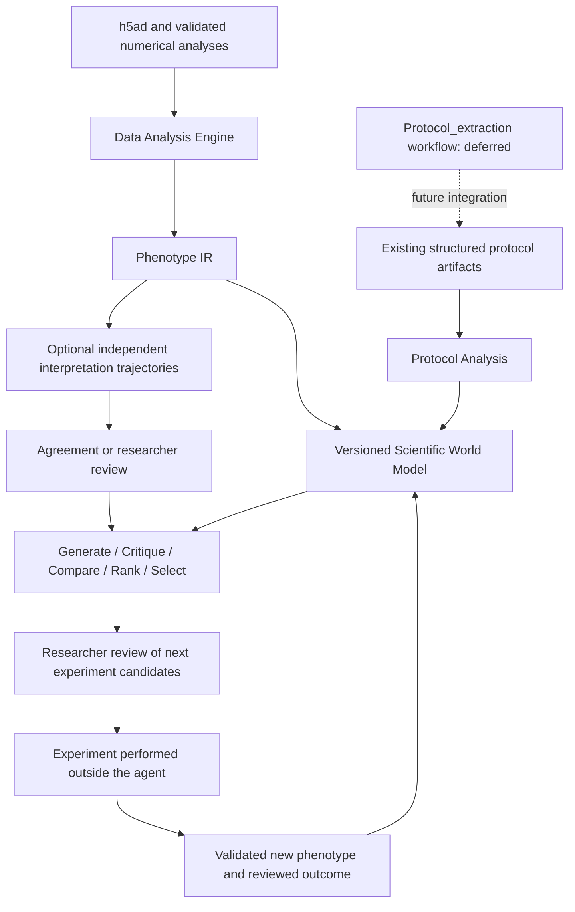

# Scientific State And Experiment Design

Implemented on 2026-09-30. This extends PA, DA, PO and Orchestrator with a structured scientific state layer; it adds no role-specific agents.

## Implemented Flow



**PA extraction is explicitly deferred.** The unstructured-protocol-to-standardized-intervention step, its final Protocol IR design, and calling the owner's `Protocol_extraction` workflow are pending. Existing PA JSON/events, deterministic matrices, comparisons and evidence retrieval continue to work. This change does not redefine their upstream extraction contract.

## State And Persistence

`scientific_models.py` defines ProtocolState, PhenotypeState, Evidence, Claim, Hypothesis, ExperimentCandidate and ExperimentFeedback. `scientific_state.py` uses Python's SQLite standard library; no graph database is required.

```text
{workspace_root}/users/{user_id}/research/{project_id}/scientific_state.sqlite3
```

`project_id` is independent of `run_id`, so evidence and hypotheses persist across runs within a study. Different users/projects have different databases. The Orchestrator accepts injected `project_id`; its default is `PROTOCOL_RESEARCH_PROJECT_ID=default`. Source data remain outside the database; protocol feature snapshots and small phenotype aggregates are stored with references to their artifacts. h5ad matrices are not copied into scientific state.

- Evidence ids depend on source references, aggregate content, run and trace. Repeating the same write is idempotent; changing an existing Evidence record is rejected.
- Entity revisions and stage events are written in one SQLite transaction. Full old payloads, outcome interpretation, actor, run and trace are retained in `history`.
- Relations use evidence ids, hypothesis ids, protocol ids and dataset ids. Unknown evidence/hypothesis references are rejected.
- A failed DA validation is recorded as failed evidence; its phenotype results do not enter the usable state.
- Regenerating a hypothesis preserves its experimental support, counterevidence and previous tests.
- Experimental support yields `SUPPORTED`, opposition yields `REFUTED`, and conflicting/absent evidence yields `UNRESOLVED`. Confidence is an ordinal label, never a calibrated probability. Association evidence is rationale, not experimental support.
- Service deployment must bind user, workspace and project access from authenticated server context. Injected LangGraph state is an integration interface, not an authentication system. Researcher identity on the local CLI is supplied by the operator; production review endpoints require authenticated identity binding.

Stages S0-S9 follow the requested scientific process. They are **per-record events**, not a single global project status: parallel hypotheses can be at different stages. S1 means existing structured protocol artifacts are available; it does not mean the deferred extraction workflow ran.

| Stage | Meaning |
| --- | --- |
| S0 | Evidence ingestion |
| S1 | Existing structured protocol available |
| S2 | Phenotype characterized |
| S3 | Protocol-phenotype association recorded |
| S4 | Hypothesis generated |
| S5 | Experiment candidate proposed |
| S6 | Researcher review |
| S7 | Experiment performed |
| S8 | New validated phenotype observed |
| S9 | Hypothesis assessed |

## DA: Computation And Interpretation

DA additionally exports `phenotype_ir.json` and `phenotype_interpretation.json`.

Phenotype IR organizes metrics into cell_identity, development, maturity, quality, expression and regulation. Each metric preserves its numeric source value, unit, method, logical sample/condition, analysis context and CSV row reference. Pending metrics retain `value=null`; they do not become numerical evidence. A marker mean-expression score is not relabeled as a validated maturity score. Source scores are not rescaled by the representation builder.

Numeric computation runs once. Interpretation operates on copies of the same numerical snapshot. An optional interpreter callback can be injected into `DataAnalysisAgent`; a configured JSON LLM client is also supported:

```json
{
  "interpretation": {
    "enabled": true,
    "trajectories": 3,
    "max_metrics": 200,
    "llm": {
      "provider": "deepseek",
      "model": "deepseek-chat",
      "api_key_env": "DEEPSEEK_API_KEY"
    },
    "claims": [
      {"claim_id": "beta_identity", "statement": "The analyzed cells show evidence of beta-cell identity."}
    ]
  }
}
```

This is an opt-in `h5ad_config` block. Defaults perform no extra LLM calls. Each of 2-5 trajectories independently assesses the same named statements, cites observed metric ids and returns supports/refutes/uncertain. Claims changing the question or citing nonexistent/unsupplied metrics are rejected. Failures, missing votes, uncertain conclusions or disagreement produce `human_review_required`; PO cannot select an eligible experiment while this gate is unresolved. Agreement is consistency checking, not statistical meta-analysis or causal validation. The configured metric budget limits each LLM payload; omitted metrics cannot be cited. LLM calls are sequential and bounded by the configured trajectory count and existing client timeout.

## Execution And Scientific Preconditions

Existing execution gates determine whether PA/DA artifacts are present, valid and joinable. The additional scientific gate checks cell line, differentiation stage, sequencing modality, reference version, endpoint method/scale, numeric phenotype availability and sufficient joinable protocols. Missing metadata is `unknown`; differing metadata is `mismatch`. Five protocols is an engineering screening floor, not a guarantee of biological or statistical validity.

Protocol comparison remains available as a descriptive operation with caveats. Unknown/mismatched metadata blocks automatic experiment shortlist eligibility; it does not forbid inspecting differences. Causal claims are not enabled by matching metadata.

Supply cell_line, stage, sequencing_modality and reference_version in source protocol metadata and DA manifest rows when available. The implementation deliberately does not infer them from paper titles or filename conventions.

## PO: Next Experiments

The existing deterministic association and evidence modules feed a new `experiment_design` node. It produces `next_experiment_candidates.json` with hypotheses, critiques, pairwise utility comparisons, ranks and a shortlist for researcher review. Existing output files remain compatible; the legacy proposal JSON additionally embeds this report and its Markdown now describes candidate experiments.

Each candidate retains its source-supported intervention suggestion and controls. No new numerical dose or timing is invented. Missing source evidence, unresolved scientific gates, missing decision assessments or prior tests without an explicit retest reason block eligibility. Multiple candidates compete; they are not declared optimal protocols.

Configure `objective.experiment_design` to provide explicit ordinal assessments, keyed by the candidate feature:

```json
{
  "primary": "increase_beta_like_maturity",
  "experiment_design": {
    "max_candidates": 10,
    "select_count": 3,
    "weights": {"improvement": 1, "information": 1, "cost": 1, "risk": 1},
    "assessments": {
      "reagent_factor_x": {
        "expected_improvement": 0.6,
        "information_gain": 0.8,
        "experimental_cost": 0.2,
        "risk": 0.3,
        "source": "researcher_reviewed_design",
        "rationale": "Compare two competing mechanisms with a matched control."
      }
    }
  }
}
```

These example values are illustrative judgments, not measured biological predictions. Utility is the configured weighted improvement + information - cost - risk. Each assessment requires an explicit source/rationale and finite scores in [0,1]. Absent assessments remain null and produce no eligible shortlist. Information gain is currently a supplied ordinal judgment; Bayesian outcome modeling and formal expected information gain are not implemented.

Evolution happens after experimental feedback: a later PO run reads prior hypothesis/test history, critiques previously tested ideas and can propose a revised or explicitly justified retest. It does not spend iterations generating identical deterministic candidates. Reviews/results contribute to the optimization cache fingerprint, so feedback invalidates old PO results.

## Registered Actions

Orchestrator tools `describe_scientific_actions`, `execute_scientific_action`, and `inspect_scientific_state` expose the registry and scientific state. Registry entries declare inputs, required inputs, execution/scientific preconditions, version, availability and outputs.

Executable actions are protocol.compare, protocol.lookup, phenotype.cell_composition, phenotype.gene_expression, phenotype.differential_expression, experiment.propose and scientific.state. Dispatch uses the existing PA/DA/PO tools and their validated pipelines. Undeclared arguments cannot override injected runtime paths or user identity. The registry describes preconditions; the corresponding domain tools execute their existing gates, and PO performs the additional scientific gate.

phenotype.beta_maturity and phenotype.reference_similarity are `partial` and are not executed through the action dispatcher. protocol.extract is `deferred` and returns `executed=false`. Literature search and other unavailable pipelines are not falsely registered as executable.

## Researcher Commands

Run `pip install -e .` to update the `scientific-state` console entry point; alternatively run `python -m protocol_optimization_agent.scientific_state_cli` in the installed backend environment. Commands work on Windows and Linux.

```bash
scientific-state --user-id local_user --project-id default snapshot
scientific-state --user-id local_user --project-id default history hypothesis HYPOTHESIS_ID
scientific-state --user-id local_user --project-id default ingest pa runs/protocol_analysis_agent_simplified_autofeatures
scientific-state --user-id local_user --project-id default ingest da runs/data_analysis
scientific-state --user-id local_user --project-id default ingest po runs/protocol_optimization
scientific-state --user-id local_user --project-id default review EXPERIMENT_ID --decision approve --researcher RESEARCHER_ID --reason "Matched design and budget checked"
scientific-state --user-id local_user --project-id default performed EXPERIMENT_ID --researcher RESEARCHER_ID
scientific-state --user-id local_user --project-id default feedback experimental_feedback.json
```

CLI commands are explicit researcher actions. Chat tools cannot approve, mark performed or record results. Eligible proposed experiments can be approved/rejected; only approved experiments can be marked performed; only performed experiments can accept feedback. Feedback requires QC-passed experimental evidence, a matching experiment id, validated numerical phenotype observations, a reviewed outcome for every linked hypothesis and a researcher interpretation. Retrying identical feedback is idempotent; changed feedback cannot overwrite an assessed result.

Use [experimental_feedback.example.json](../examples/experimental_feedback.example.json) as the payload shape. Replace its example identifiers and measurements with actual reviewed experiment and analysis records before ingestion. The schema is also available through `ExperimentFeedback.model_json_schema()`.

## Current Limits

- PA extraction and final intervention IR are deferred for later Protocol_extraction integration.
- Maturity/reference tools must still be implemented/calibrated in DA; the existing readiness gate remains active.
- LLM agreement is not a calibrated confidence measure, and differing runs of one model are not statistically independent experiments.
- Utility scores are explicit design judgments. There is no learned causal effect estimator or computed Bayesian information gain yet.
- Experiment execution occurs outside the agent; feedback recording is available, not wet-lab automation.
- SQLite supports local/server project storage and transactional writes. Distributed multi-host deployment needs a shared authenticated persistence adapter and backup policy.
- The chat UI can show returned JSON; dedicated hypothesis/experiment review UI is a later integration.
